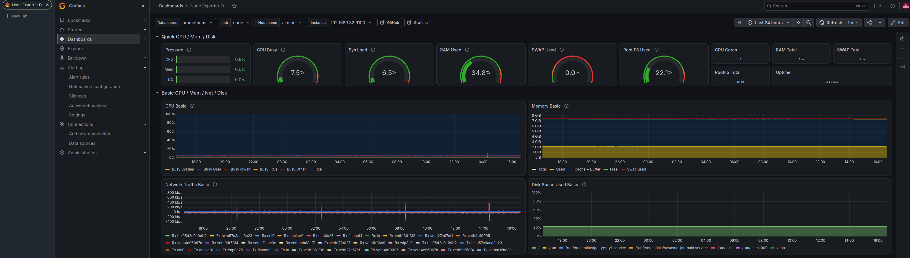
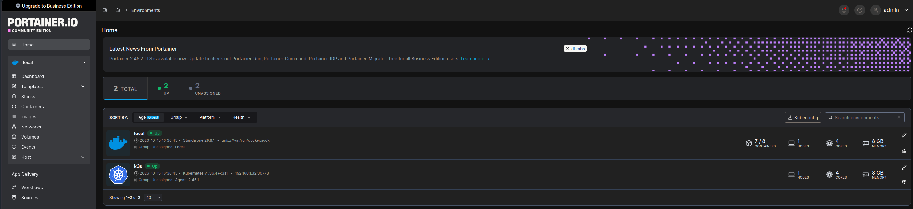
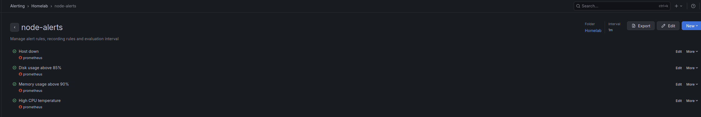

# T430 Home Media Server

A self-hosted media server and infrastructure learning project, built on a
repurposed Lenovo ThinkPad T430 running headless Debian 13, with a fully
containerized service stack and Ansible-based provisioning.



## Motivation

Built while working as a Technical Support Engineer to lean into
SRE / Sysadmin work — a way to get real hands-on practice with Linux
administration, containerization, monitoring, and infrastructure-as-code,
rather than tutorial-only exposure.

## Hardware

- Lenovo ThinkPad T430
- Intel i5-3320M @ 2.60GHz
- 8GB RAM
- 224GB Apacer AS340 SSD
- Intel HD Graphics 4000 (VAAPI hardware transcoding)

## Services

| Service | Purpose | Port(s) |
|---|---|---|
| Jellyfin | Media streaming, VAAPI hardware transcoding | host network |
| Samba | LAN file share for media ingestion | 139, 445 |
| Nginx Proxy Manager | Reverse proxy / future HTTPS termination | 80, 443, 81 |
| Prometheus | Metrics collection | 9090 |
| Grafana | Metrics dashboards | 3000 |
| node-exporter | Host-level hardware metrics | host network |
| Portainer | Management UI for Docker and k3s | 9443 |

All services are defined in [`docker-compose.yml`](docker-compose.yml) and
deployed via Docker Compose. Portainer has its own compose file in [`ansible/files/portainer-compose.yml`](ansible/files/portainer-compose.yml).

## Provisioning (Ansible)

The build is codified in three playbooks in [`ansible/`](ansible/):

- [`site.yml`](ansible/site.yml): OS hardening, Docker, fail2ban, lid-close setting, container stack
- [`k3s.yml`](ansible/k3s.yml): single-node k3s cluster
- [`portainer.yml`](ansible/portainer.yml): Portainer and its k3s agent

Run from the control machine, in the `ansible/` folder:

```bash
ansible-playbook -i hosts.ini site.yml -K --check --diff   # dry run
ansible-playbook -i hosts.ini site.yml -K                  # apply
```

Before the first run:
- Edit `hosts.ini` to point at your own target host.
- On the server, create `~/homeserver/.env` containing `SAMBA_PASSWORD=...`.
- The Prometheus config is stored in
  [`ansible/files/prometheus.yml`](ansible/files/prometheus.yml) and still has to be
  copied to `/srv/prometheus/config/` by hand.

## Management UI (Portainer)

Portainer manages both environments from one UI: the local Docker stack and the
k3s cluster (through the Portainer agent, exposed on NodePort 30778).

Portainer mounts the Docker socket, which is effectively root access to the
host. Port 9443 is kept LAN-only and is never exposed to the internet.



## Kubernetes (k3s)

A lightweight single-node k3s cluster runs alongside the Docker Compose stack.
Traefik and ServiceLB are disabled at install time, because Nginx Proxy Manager
already uses ports 80 and 443. `kubectl` runs on the control machine using the
cluster kubeconfig, pointed at the server's static LAN IP. No production
workloads run on it yet.

## Alerting (Grafana + Telegram)

Grafana alert rules notify a Telegram bot. The exported rules are in
[`grafana/alert-rules.yaml`](grafana/alert-rules.yaml).

| Rule | Condition | Pending period |
|---|---|---|
| Host down | node-exporter target `up` below 1 | 2m |
| Disk usage | root filesystem above 85% | 5m |
| Memory usage | above 90% | 5m |
| CPU temperature | above 85 C | 5m |



The Telegram bot token and chat ID are stored in the Grafana contact point only
and are not committed to this repo.


## Security notes

- SSH: key-only authentication, root login disabled
- fail2ban: bans repeated failed SSH login attempts
- The Samba password is read from '.env' file on the server ('SAMBA_PASSWORD'). '.env' is listed in '.gitignore' and is never committed.
- Portainer and all other services are LAN-only

## Documentation

- Operations guide (commands, recovery after power loss, rebuild procedure):
  [`docs/homeserver-sop.md`](docs/homeserver-sop.md)
- Debugging write-up: [`docs/samba-yaml-debugging.md`](docs/samba-yaml-debugging.md),
  a postmortem of a Samba container crash loop traced to a YAML parsing quirk in
  Docker Compose's string-form `command:` field.

## Status / roadmap

Actively maintained homelab. Planned next:

- Backups with a tested restore procedure
- CI with GitHub Actions (lint the playbooks on every push)
- Terraform on a free cloud tier, configured with the existing playbooks
- A second node (Ansible multi-host inventory, monitoring target, backup destination)
